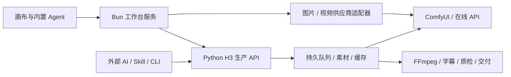

# 短剧工厂 · Short Drama Factory

以画布工作流为唯一网页入口的本地短剧创作工作台。通过图片、文本、生成节点和内置 Agent 创作；Python 生产 API 提供 H3 执行计划、持久队列、缓存、续跑、后期和交付。

**当前版本：5.0.0；Agent 协议：1。** 应用代码采用 [MIT](LICENSE)，模型和第三方资源遵循各自许可，见 [第三方声明](THIRD_PARTY_NOTICES.md)。

## 启动

双击根目录 **`启动短剧工厂.cmd`** 即可。Windows x64 源码首次启动会自动下载项目专用 Python 和 Bun、安装锁定依赖并构建工作台；请联网并保持窗口打开，首次准备可能需要数分钟。不需要提前安装 Python、Bun 或 Node.js，也不需要管理员权限。完整便携包与已准备好的源码直接复用现有环境。

准备完成后自动打开新工作台（默认 http://127.0.0.1:3001），并启动本目录生产 API（首次默认 8770）。重复启动会核对并复用实例，不自动恢复旧队列。安装中断或失败后可再次双击重试，详情见 `logs/startup.log`。自动准备只包含应用运行依赖；ComfyUI、生成模型及认证在工作台中另行配置。

开发者也可手动准备环境，在 PowerShell 执行：

```powershell
git clone https://github.com/estel-li/short-drama-factory.git
cd short-drama-factory
py -3.13 -m venv .venv
.\.venv\Scripts\python.exe -m pip install -r requirements.lock.txt
cd workbench
bun --bun install --frozen-lockfile
bun --bun run build:server
cd ..
.\启动短剧工厂.cmd
```

手动安装需先准备 Python 3.13 和 Bun 1.4.3；`python server.py` 复用已准备的环境。自动准备的运行环境、下载缓存和依赖保存在本项目目录，不修改系统 Python 或系统 PATH。新版便携包构建包含 Python、Bun、新工作台和 Silero VAD CPU 质检模型。

参数：`--no-browser` 不打开浏览器；`--workbench-port 3002` 指定画布端口；`--port` 指定与保存配置一致的生产 API 端口。`--serve-only --port 8770` 仅启动 API，省略端口仍兼容外部 CLI 的原默认 8765。

旧 `web/` 页面和旧网页启动选项已移除。API 根路径返回服务说明，不能当作画布页面。完整安装、连接与已知边界见 [Windows 工作台说明](docs/windowsWorkbench.md)。

## 主要工作流

- **画布与 Agent**：文本、图片、视频、音频素材和生成节点；默认 DeepSeek，支持常见或自定义文本供应商编写剧本、分镜与提示词。
- **图片**：ComfyUI 的 SD / SDXL、FLUX Schnell、Qwen Image 2.1 Turbo 文生图与图生图／单图编辑预设；支持自定义 API 工作流和在线供应商。
- **视频**：ComfyUI H3 文生视频／首帧图生视频，或配置在线供应商；工作流须匹配实际模型与组件。
- **H3 工厂节点**：参考图导入、项目创建、镜头展开、局部编辑、计划执行、任务续跑、成片取回与校验。
- **本地环境**：选择已有 ComfyUI、自动安装清单、模型搜索与目录接入；NVIDIA 限功率／频率命令生成。
- **制作插件**：换装捏人、ComfyUI 原始工作流、导演工具、剧本创作和 H3 提示词技能。

配置入口为“设置 → 文本模型／图片模型／视频模型／ComfyUI 环境”。图生图先将原图连接到图片生成节点，再选择对应模型。Qwen 的文生图与图生图需要分别加入画布模型列表。详见 [使用说明](使用说明.md)。

## 生产后端与外部 AI

H3 节点通过版本化 API 调用原生产服务。镜头 UID、项目 revision、幂等回执、素材摘要、执行计划和缓存共同保证任务可追踪；请求结果未知时先查询原任务，不重复创建。

后端仍保留素材、参考图、字幕、人声质检、连续镜头、成片版本、导入导出、导演风格及历史整剧任务的实现。这些是生产服务和 Agent 接口的依赖，移除旧网页不等于移除生产能力。

外部 Codex、Claude、Gemini 等本机 AI 使用 [AGENTS.md](AGENTS.md) → [视频制作 Skill](agent-skills/short-drama-factory/SKILL.md)。可将 `agent-skills/short-drama-factory/` 安装到对应工具，也可直接运行其 CLI：

```powershell
.\.venv\Scripts\python.exe agent-skills/short-drama-factory/scripts/sdf.py start --app . --port 8770
.\.venv\Scripts\python.exe agent-skills/short-drama-factory/scripts/sdf.py doctor
```

默认由当前 AI 写分镜与提示词，严格渲染不隐式调用文字模型或下载。导演风格学习见 [导演风格 Skill](agent-skills/director-style/SKILL.md)。只有云端聊天能力的 AI 无法直接访问本机回环服务。

## 技术结构



| 目录 | 职责 |
| --- | --- |
| `workbench/` | Vue 画布、Agent、Bun 服务、供应商和节点插件 |
| `app/`、`pipeline.py` | 生产 API、渲染、缓存、续跑、后期和交付 |
| `agent-skills/` | 外部 AI 操作协议和命令行 |
| `skills/`、`resources/` | 内部文字模板、原始参考与许可 |
| `manifests/`、`nodes/` | 模型清单及 ComfyUI 缓存节点 |
| `launcher/` | 统一启动与便携包构建 |

画布数据在 `workbench/data/`，生产配置、数据库和项目在根目录 `config/`、`data/`、`projects/`。保留这两组数据目录。详见 [架构与清理边界](docs/architecture.md)、[配置说明](docs/configuration.md)。

## 开发与验证

后端保留现有检查：

```powershell
.\.venv\Scripts\python.exe -m unittest discover -s tests -p "test_*.py"
.\.venv\Scripts\python.exe tools/generate_agent_contract.py --check
```

工作台的构建、类型检查和手动联调在 `workbench/` 进行。旧网页专属检查与根目录 npm 工程已移除。当前类型检查仍受已知 `ElectrobunConfig` 本地开发类型缺失影响，详见工作台说明。真实生成验证会使用 GPU 或供应商额度，仅在明确范围内执行。
