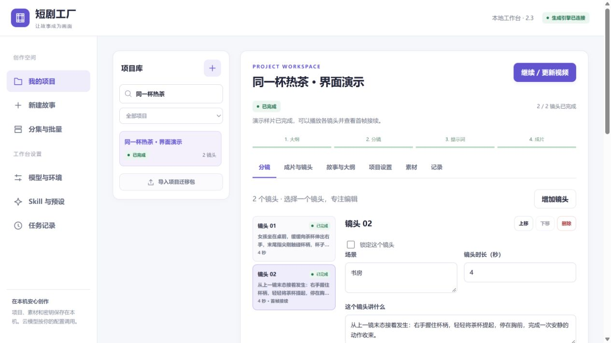
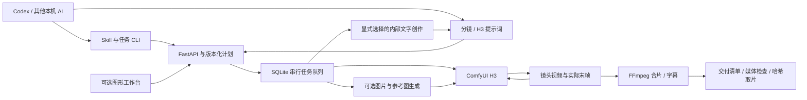

# 短剧工厂 · Short Drama Factory

> **让 AI 操作本项目：先读 [AGENTS.md](AGENTS.md)，再按 [视频制作 Skill](agent-skills/short-drama-factory/SKILL.md) 执行。** 内含调用脚本、请求模板、故障诊断与成片验收。Claude、Gemini 也有根目录入口文件。

一个由 AI 工具驱动的本地视频生产服务。用户在 Codex、Claude、Gemini 或其他本机 AI 中提出需求，通过 Skill、命令行与 API 完成创作、素材绑定、生成、修复和交付。图形工作台作为可选的审片与高级编辑界面。

默认由当前 AI 编写分镜和 H3 提示词，严格渲染不会调用内部文字模型。需要工厂代写时，可显式选择 DeepSeek、Ollama、LM Studio 或兼容服务，分别配置大纲、分镜与提示词阶段。

**当前版本：4.1.1。** 应用代码采用 [MIT 协议](LICENSE)。模型、上游参考文档与第三方工具分别遵循其自身许可，详见 [第三方声明](THIRD_PARTY_NOTICES.md)。



## 功能

- **以 AI 为主入口**：独立 Skill、任务级 CLI 与版本化 API 覆盖草稿、素材、执行计划、生成、修复、恢复和交付，无需打开客户端。
- **导演风格 Skill**：提取参考片的画面、连续片段、密集时序图和音轨，由当前 AI 分析构图、运镜、剪辑、动作、特效与声音，生成用户自己的风格包。默认用其风格讲新故事，明确选择后也可按参考结构仿拍。见 [4.1 使用与实现](docs/director-style-4.1.md)。
- 幂等提交回执、项目 revision、固定镜头范围与资源检查；默认外部 AI 创作，严格 render 不隐式调用文字模型或下载。
- 当前成片完整解码、版本来源检查、SHA256 校验取片与审核材料；多项目按已确认计划逐项提交并分别恢复。
- 四种输入：一句话灵感、已有大纲、完整剧本、分镜 JSON。
- 全自动生成，或在大纲、分镜、提示词阶段暂停检查。
- 4 个大纲、4 个分镜、5 个 H3 提示词及 4 个图片提示词 Skill；可复制、编辑、导入和导出。
- **7 种生图模型**：Qwen-Image 2.1、SDXL、Animagine XL、DreamShaper 8 / XL Turbo、FLUX Schnell 和 Z-Image Turbo，使用各自的原生 ComfyUI 图。支持原图重绘；Qwen 额外支持多图语义参考和透明通道。保留提示词、种子、参考图快照和实际采样参数。
- **新增 3 条视频工作流**：LightX2V 8步、PDD Acc、PDD 神经潜空间放大与轻精修；优先复用已有 H3 模型，可另存参数组合。缺资源时确认下载、查看进度、暂停续传。详见 [工作流与模型指南](docs/advanced-workflows.md)。
- **5 类 H3 专用媒体工作流**：原声驱动数字人、锁画面拟音、中段关键帧、音画多帧接续与视频轮廓控制；按单镜绑定源素材，支持独立配置。详见 [3.3 高级工作流](docs/h3-advanced-3.3.md)。
- **项目参考图**：可选自动生成角色、场景和道具图，绑定到对应分镜，支持单项重生成及采用历史版本。详见 [图片生成指南](docs/image-studio.md)。
- 3.0.1：缺模型先确认并显示下载进度，可选已有模型文件、删除图片；优化后沿用原任务生成。
- 自定义风格、题材、画幅、时长、镜头数、种子与质量；支持预设和个人预设。
- H3 五种模式：T2VA、I2VA、FL2VA、L2VA、Ref2VA，支持图片、视频和声音素材。
- **首帧功能**：AI 判断同场景连续镜头是否需要接续，自动把上一镜头的实际末帧送入当前镜头的 I2VA 首帧槽。
- 单镜头编辑、排序、锁定、重写提示词、换种子重生成与历史版本。
- 中文台词建议每秒约 5.6 个字，按语境、场景、情绪和动作动态安排节奏；估算超时仅提醒。支持角色与参考一致性预检、单镜试生成和已验收提示词样板。
- CPU 人声检测、三档同步音画剪辑、人声字幕对齐、注释与动态多边形遮罩。
- 总览、密集抽帧与切口对照，冻结原片和后期配方，多版本保存与重建。详见 [出片质量流程](docs/quality-pipeline.md)。
- 后期设置独立保存，成片注释直接填写时间和文字；缺原片时提前提示，长片审核分批写盘，视频迁移按块处理。
- 1～100 集的整剧规划与批量队列，共享角色设定；失败后继续其他集或暂停本批。
- 网络/API 重试与输出格式修复分别配置，默认各额外重试 3 次。
- 条件编码、采样、解码分阶段执行并保存缓存；支持停止、重启与续跑。
- 项目迁移与素材导出；标准包和迁移包排除认证信息。
- 复用本地 ComfyUI、从零安装，或连接远程 ComfyUI；模型按固定清单从 Hugging Face 下载并校验。

## 运行要求

| 部分 | 要求 |
| --- | --- |
| 服务端 | Windows x64、Python 3.13、可写安装目录；浏览器为可选界面 |
| 本地生成 | 支持当前 ComfyUI/PyTorch 的 NVIDIA 驱动及显卡 |
| 已验证配置 | RTX 5060 Ti 16GB、H3 W4A8、0.4MP、4 步快速预览 |
| 文字模型（可选） | 仅使用工厂内部创作时配置；默认外部 AI 提供完整分镜和提示词 |
| 磁盘 | 应用依赖、ComfyUI、模型、下载缓存及成片分别占用空间；先预览安装清单 |
| 网络 | 首次下载依赖/模型，以及调用云端文字模型时需要联网 |

16GB 显存的默认使用范围为每镜头 4～8 秒；0.6MP 和更高步数会增加计算量。高级设置允许 8～15 秒，需在目标机器独立验证。H3 使用 24fps 和 `17k+5` 帧对齐，4 秒请求实际生成 107 帧，约 4.458 秒。

工作台环境与 ComfyUI 推理环境相互独立。可以使用远程 GPU，但从零自动安装目前面向 Windows x64 + NVIDIA。

工作台自启本地 ComfyUI 时，把输入素材、输出、数据库和生成缓存放在工作台的 `data/comfy-runtime/`，通过额外节点目录加载随包节点。已有 ComfyUI 安装目录和模型目录可只读。手动启动的 ComfyUI 仍使用它自身配置，需要加载兼容的缓存节点。

## 从 AI 与命令行开始

应用使用 Python 3.13；技能 CLI 只需 Python 3.10+ 标准库。Windows 便携包已包含应用 Python 与依赖，模型和认证另行配置。源码依赖安装方法见后文。

在应用目录执行：

```powershell
.\.venv\Scripts\python.exe agent-skills/short-drama-factory/scripts/sdf.py start --app .
.\.venv\Scripts\python.exe agent-skills/short-drama-factory/scripts/sdf.py doctor
```

`start` 默认仅启动 API，保存实例绑定，不打开网页或恢复旧队列。复用已运行实例时返回实际队列模式。端口可用 `--port 8770`；连接已有服务可用 `connect --app 应用目录 --url http://127.0.0.1:8765`。

将技能安装到 AI 可发现的位置，例如 Codex：

```powershell
.\.venv\Scripts\python.exe agent-skills/short-drama-factory/scripts/install_skill.py --target "$env:USERPROFILE/.codex/skills/short-drama-factory"
```

安装工具离线执行，支持 `--update`，保留备份及个人文件，检测到本地修改不会静默覆盖。任意本机 AI 也可直接读取 [SKILL.md](agent-skills/short-drama-factory/SKILL.md)。完整命令见 [无界面使用指南](docs/ai-agent-usage.md)。

使用当前 AI 填好的请求创建并生成：

```powershell
.\.venv\Scripts\python.exe agent-skills/short-drama-factory/scripts/sdf.py produce --json project-request.json --request-key my-first-film --wait 45
```

请求回执保存在当前工作目录的 `.sdf/`。超时后查询原请求或原任务；退出码 3 表示后台仍在运行。也可分开执行 `project create / validate / plan / run`。模型尚未就绪时先处理明确缺项，不会隐式下载。

任务完成后核对当前成片并下载到新目录：

```powershell
.\.venv\Scripts\python.exe agent-skills/short-drama-factory/scripts/sdf.py deliver PROJECT_ID --verify --output delivery-v1
```

交付清单记录项目／版本、文件哈希、实际规格、审核材料和未验证项。--verify 完整解码当前成片；画面、台词及字幕是否符合要求仍需查看与试听。技术条件未通过返回退出码 2，已有材料和失败证据会保留。

多个项目可用 `batch --json batches.json --request-key batch-1` 逐项提交已创建的计划。批次不是原子事务：某项失败不取消其他项，输出独立回执；仅显式 `--retry-unknown` 才补交未知结果。输入格式及恢复方式见 [CLI 参考](agent-skills/short-drama-factory/references/cli.md#批量提交已有计划)。

## 安装应用与可选工作台

### 1. 从源码安装应用

在 PowerShell 中执行：

```powershell
git clone https://github.com/estel-li/short-drama-factory.git
cd short-drama-factory
py -3.13 -m venv .venv
.\.venv\Scripts\python.exe -m pip install -r requirements.lock.txt
.\.venv\Scripts\python.exe .\launcher\start.py --serve-only
```

--serve-only 启动 API 后，按前文绑定 Skill 即可制作。需要图形工作台时访问 <http://127.0.0.1:8765>；关闭网页后任务仍会继续。再次启动会复用同目录服务，端口冲突时指定 --port 8770。启动入口直接使用应用 Python，无需修改 PowerShell 执行策略。

Windows 便携包包含应用 Python 和依赖，解压到可写目录后可从前文的 CLI 启动；ComfyUI、模型和认证信息另行配置。双击 `启动短剧工厂.cmd` 使用传统启动方式并打开工作台，也会恢复旧队列。仓库不包含这些大型运行文件。

### 2. 连接生成环境

打开“模型与环境”，选择一种方式：

- **已有本地环境**：填写 ComfyUI 根目录、它的 Python 路径、服务地址和模型搜索目录。预览安装清单后复用模型，工作台自启引擎时会加载随包缓存节点。已有服务需重新启动以加载新增模型路径；手动启动 ComfyUI 的用户仍需自行安装或更新缓存节点。
- **从零安装**：指定安装目录、模型目录和已有模型搜索目录，预览下载清单后开始安装。按清单下载官方 ComfyUI、需要的模型与推理依赖；支持校验和断点恢复。
- **远程服务**：填写服务地址，在远端把 `nodes/ComfyUI-DramaFactory` 放进 `custom_nodes` 并重启。服务认证在工作台独立填写。

“从服务获取可用模型”可检查模型与节点。“运行 4 秒环境验证”会使用 GPU 生成验证样片，不调用文字模型。

### 3. 配置文字模型（可选）

在提供商设置中填写自己的 DeepSeek key，选择模型并测试连接。也可配置本地 Ollama、LM Studio 或其他兼容服务。默认模型为 `deepseek-flash`；以你使用的提供商实际支持的模型名称为准。

大纲、分镜与 H3 提示词可分别选择提供商、模型、Skill。认证信息保存在本机 `.secrets/`，不会写入公开配置。

### 4. 创建短剧

1. 在“新建故事”输入大纲或剧本。
2. 选择风格、时长、镜头数量、画幅和生成质量。
3. 选择全自动，或逐阶段检查。
4. 查看分镜，按需修改、保存；继续生成镜头和成片。
5. 在项目工作区播放、下载视频，或导出迁移包。

整剧批量生成使用“分集 / 批量”。完整操作见 [使用指南](使用说明.md)。

### AI 与工作台共同编辑

工作台与 CLI 使用同一项目和队列。AI 修改前读取最新 revision，提交后重新计划；不要用旧草稿覆盖工作台刚保存的内容。工作流、模式和真实素材约束见 [工作流选择指南](agent-skills/short-drama-factory/references/workflow-selection.md)，无需先打开网页才能查阅。

示例请求：`使用 $short-drama-factory，把这份大纲做成 6 镜、9:16 的短片，先检查分镜，再生成并验收。` 技能按当前任务读取外部分镜、人物参考、原声、连续镜头或局部修复模板。Qwen-Image 2.1 权重采用非商用研究许可，商业用途需模型方授权。

AI 需能访问运行服务的电脑。只有云端聊天能力的 AI 无法直接访问本机端口；本地技能不会公开服务、携带密钥或自动下载模型。外部操作技能与工作台内部文字模板分开安装。

## 首帧功能

每个分镜都有 `use_previous_last_frame`，默认 `false`。AI 分镜人依据场景、连续段和动作边界判断是否启用，并填写 `first_frame_reason`；用户也可在分镜表调整。

启用后，当前镜头强制使用 **I2VA**。程序先确保紧邻上一镜头的视频完成，再完整解码至最后一个显示帧，保存无缩放的 PNG 并传给 H3。提示词使用官方 0 秒对齐指令，要求从该画面的状态接着表演。

第一镜、换场、时间跳跃、闪回和需要硬切的镜头不应启用。首帧功能与自动角色参考独立；未选中的镜头继续使用原模式及绑定。原手工绑定保留，关闭首帧功能后继续生效。

前镜改动会使依赖缓存更新；锁定的依赖镜头会提示解锁，避免悄悄复用旧首帧。详细契约、排序与恢复行为见 [首帧功能说明](docs/first-frame.md)。

## 技术结构



后端使用 Python、FastAPI、Pydantic 和 SQLite；前端使用原生 JavaScript/CSS，无需 Node 构建。视频处理使用 PyAV 和随 `imageio-ffmpeg` 提供的 FFmpeg。

```text
app/          API、配置、文字生成、项目、队列、安装与迁移
web/          浏览器工作台
pipeline.py   ComfyUI 工作流、顺序渲染、缓存与合片
agent-skills/ 外部 AI 操作技能、任务 CLI、模板与按需参考
skills/       工厂内部文字生成模板
resources/    可移植的内置 Skill 原文、适配层与来源记录
manifests/    固定版本的模型/运行环境下载清单
nodes/        ComfyUI 条件与潜空间缓存节点
launcher/     启动、便携包构建和资源维护
tests/        自动化测试与可选真实环境验证
docs/         结构、配置和首帧功能文档
```

项目数据、日志、认证信息、模型、下载缓存和构建产物均由 `.gitignore` 排除。更多边界见 [架构说明](docs/architecture.md) 和 [配置说明](docs/configuration.md)。

## 开发与验证

```powershell
.\.venv\Scripts\python.exe -m unittest discover -s tests -p "test_*.py"
```

后端单元和集成测试不需要真实 API key 或 GPU。前端回归测试可选使用 Node.js 20+ 执行 `npm test`，覆盖草稿保留、异步保存、队列与错误提示；应用运行本身不需要 Node.js。首帧测试包括默认关闭、跨批接续、准确末帧、旧提示词缓存兼容、顺序渲染、恢复以及上游视频改动后的缓存失效。

可选真实验证会使用当前配置的 API，并创建新项目；加 `--render` 后还会使用 GPU：

```powershell
.\.venv\Scripts\python.exe tests/live_first_frame.py --render
```

构建 Windows 便携包：

```powershell
.\.venv\Scripts\python.exe launcher/build_portable.py
```

构建过程下载固定 Python 运行时与应用依赖，产物写入 `dist/`，不包含私人配置、认证或模型。

## 常见问题与边界

- **文字请求失败**：查看任务记录及项目 `requests/`。网络/API 错误与 JSON/模式校验错误分别记录；在提供商高级设置调整超时、网络重试及格式修复次数。
- **缺少节点或模型**：获取实时节点/模型清单，核对当前 H3 版本与下载清单，安装缓存节点后重启 ComfyUI。
- **显存不足或显卡断开**：先降低到 0.4MP / 4 步 / 4 秒，并检查驱动及硬件连接。继续任务会复用已完成镜头。
- **首帧镜头保存失败**：检查是否是第一镜，或是否与上一镜头的场景、连续段冲突。排序后以当前相邻顺序为准。
- **长项目中断**：继续原项目，避免重复创建；分镜批次、条件和潜空间缓存可恢复。
- **人物和动作连续性**：首帧约束与参考素材能改善连续性，模型输出仍需播放检查。字幕先跟随检测人声，再按字数估算句内时长；支持人工时间标注，目前没有 ASR 逐字核验。

工作台默认只监听 `127.0.0.1`，面向本机使用；需要远程 GPU 时配置 ComfyUI 服务。独立配音、统一配乐、剪辑工程导出和更多视频模型尚未实现。

## 参与贡献

欢迎提交问题与改进。请先阅读 [贡献指南](CONTRIBUTING.md)；漏洞与密钥问题按 [安全说明](SECURITY.md) 私下报告，公开 Issue 请去掉 key、token、剧本和私人路径。

版本变更见 [CHANGELOG](CHANGELOG.md)。应用与本地适配代码使用 MIT；不对第三方文档、模型权重、工具和库重新授权。
